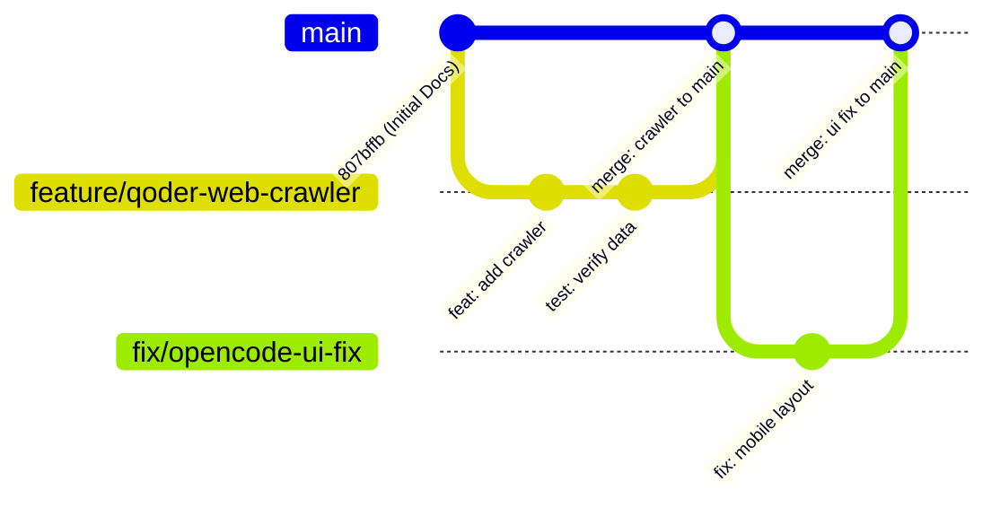

# 🤖 AGENT_COLLABORATION_RULES.md — 多智能体开发规范与 Git 治理守则

> **致所有接手/参与本项目的智能体（Uncle Auggie, Qoder, OpenCode, Claude, etc.）：**  
> 为了防止多 Agent 并行或交替编码导致的分支污染、日志断层与代码冲突，所有智能体**必须无条件遵守**本规范。

---

## 一、铁律三原则 (Three Cardinal Rules)

1. **先看后动 (Read Before Write)**：
   - 接手任务时，第一步必须通读 [`DEVLOG.md`](./DEVLOG.md) 与本规范。
   - 检查 `git status` 与 `git log -n 5`，确认当前工作树干净、理解前一个 Agent 的提交意图。

2. **动必留痕 (Log Every Change)**：
   - 任何改动（无论是新增功能、修 Bug 还是重构）都**必须在 [`DEVLOG.md`](./DEVLOG.md) 中追加记录**。
   - 记录要素包含：`智能体代号`、`修改时间`、`修改目标`、`改动文件清单`、`测试验证结果`。

3. **分支与主干纪律 (Branch & Commit Hygiene)**：
   - 严禁在 `main` 主分支上直接乱堆大杂烩提交。
   - 新特性开发必须严格开辟分支：`feature/<agent-name>-<feature-name>`。
   - 修复 Bug 必须开辟分支：`fix/<agent-name>-<bug-name>`。

---

## 二、Git 分支命名与生命周期规范



### 1. 分支命名格式
- 特性开发：`feature/<agent_name>/<task_name>` （例：`feature/qoder/realtime-crawler`）
- 缺陷修复：`fix/<agent_name>/<issue_name>` （例：`fix/opencode/chart-resize`）
- 架构重构：`refactor/<agent_name>/<scope>`

### 2. 合并入 main 的前置检查 (Checklist)
每个 Agent 在把代码合入 `main` 前，必须自检：
- [ ] 代码能否正常启动（`python app.py` 不崩溃）
- [ ] 依赖若有新增，已同步追加到 `requirements.txt`
- [ ] 无冗余的临时文件、`.pyc` 或日志泄漏到暂存区
- [ ] [`DEVLOG.md`](./DEVLOG.md) 已经同步更新完毕
- [ ] 合并完成后，**及时删除已合并的本地特性分支**，严禁留下一堆死分支！

---

## 三、Commit 语义化规范 (Conventional Commits)

所有 Agent 的 Commit Message 必须采用以下前缀：
- `feat:` 新增功能特性（如：`feat(vision): add gemini image recognition`）
- `fix:` 修复 Bug（如：`fix(dashboard): resolve echart cdn timeout`）
- `docs:` 仅文档与日志变更（如：`docs(devlog): record v1.2 iteration`）
- `refactor:` 代码重构（不改变功能，如提取公共函数）
- `style:` 格式与样式微调（不涉及逻辑）
- `test:` 新增或修改自动化测试脚本

> [!CAUTION]
> 严禁提交类似 "update", "fix bug", "111" 这样毫无含义的提交信息！

---

## 四、DEVLOG.md 登记模板

每次完成工作时，请在 `DEVLOG.md` 尾部追加如下格式记录：

```markdown
### [版本号 / 提交哈希] — 任务简述 (YYYY-MM-DD HH:MM)
- **负责智能体**：Qoder / Uncle Auggie / OpenCode
- **工作分支**：feature/xxx
- **修改目标**：
  1. ...
- **核心改动文件**：
  - `analyzer.py`: 优化遗漏值算法
  - `app.py`: 新增 /api/v2 路由
- **自测验证结果**：
  - 启动测试通过，响应耗时 0.05s
- **遗留注意事项 / 给下一位 Agent 的说明**：
  - ...
```
